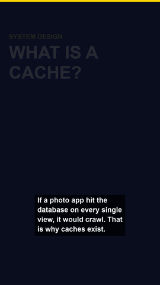
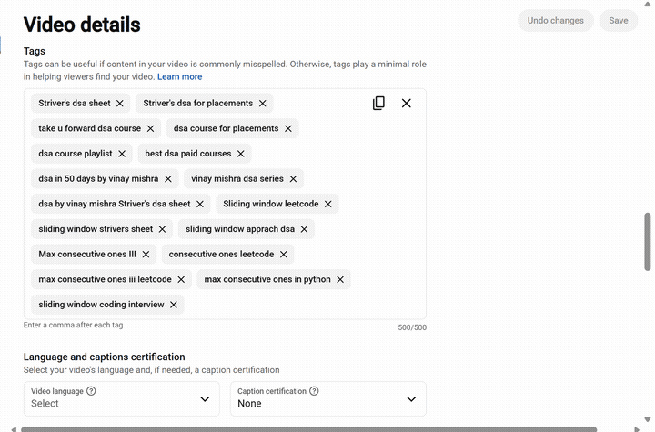
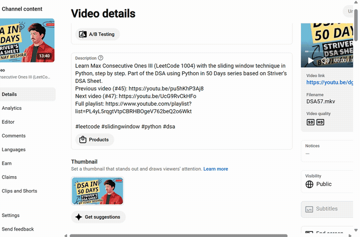
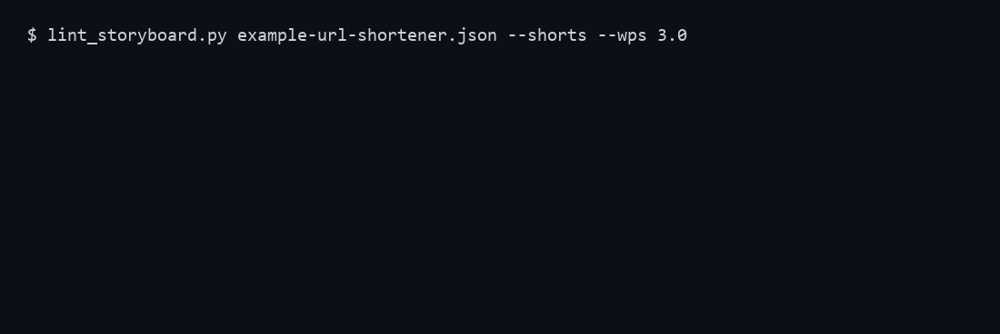

# vinx-youtube-skills


> Fix a YouTube channel one **verified** change at a time, and make short teaching videos with an
> offline voice. No API keys, no packages, no accounts.

Nineteen skills that fix a YouTube channel one verified change at a time. They are plain
instruction files plus small Python scripts (standard library only, no packages, no API keys), for
Claude Code or any agent that can read a `SKILL.md`.

The idea that runs through all of them: **a change is only real once it has been read back from
YouTube.** Several tools here exist because a first version reported edits as saved when Studio had
quietly refused them.

Nothing here publishes a video. The skills write and check; you decide.

## Demo

Every video below was built by `yt-explainer` / `yt-short-explainer` from a small JSON storyboard.
Click a preview to open the full MP4. The Shorts use the offline Piper voice and are synthetic; the
landscape example uses the older Windows system voice.

| System design Short: URL shortener | DSA Short: binary search | System design Short: cache |
|---|---|---|
| [](docs/demo/url-shortener-short.mp4) | [](docs/demo/binary-search-short.mp4) | [](docs/demo/cache-short.mp4) |

Long-form (1280x720, about 2.5 minutes): [](docs/demo/binary-search-explainer.mp4)

### Editing in YouTube Studio

Recorded from a real Studio session with Playwright. Tags first: remove two tags to make room under the
500 counter, type a new tag, watch the counter change. Then the description. These recordings stop
before **Save**; the changes were undone and the page reloaded to confirm nothing was kept. In real use
the skills save and then reload to read the value back (see `yt-studio`).

| Tags | Description |
|---|---|
|  |  |

### Tested

Real output from the linter, the tag counter and the builder (storyboard lint, tag count against
Studio's 500 limit, final build):



## Quick start

```bash
# 1. Get the skills into Claude Code
cp -r skills/* ~/.claude/skills/            # Windows: copy the folders into %USERPROFILE%\.claude\skills\

# 2. Tell the writing skills how you talk
mkdir -p ~/.claude/youtube && cp templates/voice.md ~/.claude/youtube/voice.md   # then edit it

# 3. Ask your agent, in plain language
#    "Boost this video: https://studio.youtube.com/video/<ID>/edit"
#    "Audit my playlist <URL> for titles with no topic"
#    "Make a 45-second Short explaining binary search"
```

### Try the scripts directly

```bash
# Tags that fit Studio's real 500 counter
python3 skills/yt-tags/tags.py count "binary search, dsa, python"
python3 skills/yt-tags/tags.py suggest --seed "binary search" --max-new 10

# Why is a video stuck? (impressions, click rate, average view duration)
python3 skills/yt-diagnose/diagnose.py --help

# Playlist audit
python3 skills/yt-series/series.py --help

# Build a vertical Short from a storyboard
python3 skills/yt-explainer/lint_storyboard.py skills/yt-short-explainer/example-binary-search.json --shorts
python3 skills/yt-explainer/build_video.py skills/yt-short-explainer/example-binary-search.json out/short \
    --format shorts --voice /path/to/en_US-ryan-high.onnx
```

The video builder needs [ffmpeg](https://ffmpeg.org). For a natural voice, set up Piper as described in
`skills/yt-short-explainer/SKILL.md`; without it the builder uses the system voice.

## What is different here

- **Tags counted the way Studio counts them.** The 500 limit is not a character count. The real rule
  (`sum of lengths + commas + 2 per tag containing a space`) was checked against Studio's own counter,
  and `tags.py` never produces a list that will not save.
- **`yt-diagnose`** tells you whether a video is not shown, not clicked or not watched, from its
  Studio numbers, so you fix the first broken stage and not the one that feels easiest.
- **`yt-series`** audits a whole playlist: titles with no topic, missing numbers, and episodes that
  all share one thumbnail. On a real 100-video series it found 20 topic-less titles and 32 videos on
  the same image.
- **`yt-boost`** runs one video end to end: diagnose, title, description, tags, chapters,
  monetization, thumbnail, then reload and verify each field.
- **`yt-monetize`** audits mid-roll across videos. It follows YouTube's own automatic slots, because
  evenly spaced manual slots were all marked "unlikely to show ads" in testing.
- **`yt-studio`** is the procedure for editing Studio safely: record the original, edit one video
  first, type tags with real key presses, reload to prove it saved.
- **`yt-explainer`** turns a storyboard into a 1 to 3 minute narrated video with captions, using an
  offline system voice and ffmpeg. The voice is synthetic and the skill says so.

## The skills

| Skill | What it does |
|---|---|
| `yt-boost` | One video, everything that can be fixed from Studio, verified |
| `yt-diagnose` | Shown, clicked or watched: the first thing holding a video back |
| `yt-series` | Playlist audit: topics, numbering, duplicate thumbnails |
| `yt-tags` | Real search phrases as tags, always under the 500 counter |
| `yt-monetize` | Mid-roll audit and break marks that give YouTube natural breakpoints |
| `yt-studio` | Safe editing in YouTube Studio, with read-back verification |
| `yt-explainer` | Story-structured teaching video from a storyboard: step-by-step visuals, offline voice, captions, chapters, compliant description; includes a storyboard linter |
| `yt-short-explainer` | Under-a-minute vertical (9:16) Shorts explaining one DSA or system design idea in English with an offline neural voice; shares the explainer builder and linter |
| `yt-script` | Hook options off 21 formulas, scored, then the script |
| `yt-package` | Title and thumbnail linted as one pairing |
| `yt-seo` | Description and search-facing text |
| `yt-chapters` | Chapters from a transcript, validated against YouTube's rules |
| `yt-retention` | Where viewers leave, from a retention export |
| `yt-edit` | Edit decision list from a transcript |
| `yt-shorts` | Shorts hiding inside a long video |
| `yt-comment` | Comment triage and replies |
| `yt-plan` | A realistic upload week |
| `yt-audit` | Channel audit that ends in one fix |
| `yt-viral` | What is working in a niche, ranked by outlier multiple |

## Repository layout

```
skills/<name>/SKILL.md   the instructions an agent reads
skills/<name>/*.py       small standard-library helpers
templates/voice.md       your writing voice, read by the writing skills
.claude-plugin/          plugin and marketplace metadata
LICENSE                  MIT, both copyright notices
```

## Install

Copy the folders you want from `skills/` into `~/.claude/skills/` (or a project's `.claude/skills/`),
or use the plugin files in `.claude-plugin/`. Then fill in `templates/voice.md` and put it at
`~/.claude/youtube/voice.md`; every writing skill reads it.

The scripts need Python 3. On Windows run them with `py` or `python` where the docs say `python3`.

Skills that edit Studio need a browser you are already signed in to. You sign in; no skill asks for
or handles a password.

## Honest status

Tested on one real channel (a 105-video Hindi coding-tutorial playlist): the tag counter, tag
suggestions, the mid-roll audit, the playlist audit, title/description/tag edits with read-back
verification, thumbnail upload, and playlist edits. All scripts compile and run; the inherited
scripts (`hookscore.py`, `title.py`) were smoke-tested with sample input, the others were not
exercised against real transcripts. Studio's page layout changes without notice, so selectors in
`yt-studio` can break; the verification step is there to catch that.

Not done or not verified: chapters from a real transcript, editing translated titles, mid-roll
placement on videos over an hour. YouTube's rules and the thresholds in `yt-diagnose` are rules of
thumb, not guarantees. No skill can promise a video will rank or go viral.

## Responsible use

Videos made with `yt-explainer` and `yt-short-explainer` use a synthetic voice. Disclose that, have a
person watch and fact-check every video, and read YouTube's current policies on repetitive and
synthetic content before relying on monetization. Check the licence of any voice model you download.

## Credit and licence

This project began as a fork of [youtube-agent-skill](https://github.com/Jakeschincariol/youtube-agent-skill)
by Jake Schincariol (MIT). The original eleven skills and their scripts come from that project and
keep its copyright notice; the eight added skills (`yt-boost`, `yt-diagnose`, `yt-series`, `yt-tags`,
`yt-monetize`, `yt-studio`, `yt-explainer`, `yt-short-explainer`) and the changes to the others are new.

Released under the MIT licence; see `LICENSE`, which keeps both copyright notices as the licence
requires.
